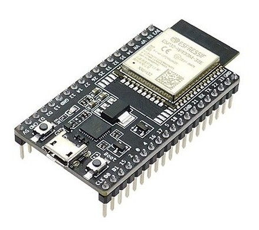
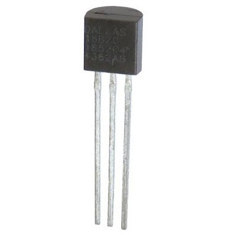
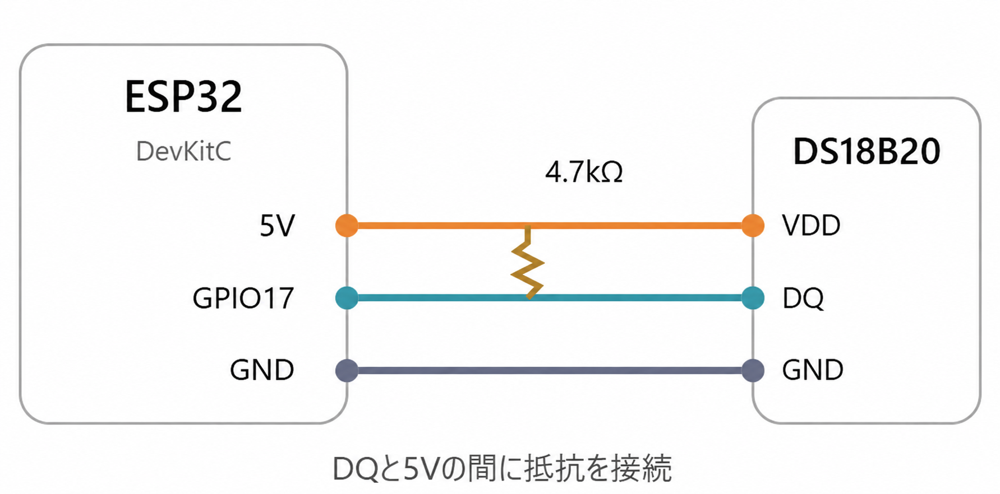

# STEP 1：ESP32で温度を測ろう

[🏠 トップ](../README.md) | [← 事前準備](00-setup.md) | [次へ：STEP 2 →](02-server.md)

## 今日ここでできるようになること

**ESP32に接続した温度センサで測定した温度を、パソコンの画面に表示します。**

## 1. 配線する

**USBケーブルを必ず外してから** 作業します。

### 1-1. DS18B20の端子を確認する

まず、温度センサ「DS18B20」の端子配置を確認しましょう。

DS18B20には、以下の3つの端子があります。

| 端子名 | 役割 |
| --- | --- |
| VDD | 電源 |
| DQ | データの送受信 |
| GND | グランド（0V） |

各端子の位置は、以下のデータシートで確認できます。

📄 **[DS18B20 データシート（PDF）](https://akizukidenshi.com/goodsaffix/DS18B20.pdf)**

データシートの **1ページ目「PIN CONFIGURATIONS」** にある
**TO-92（DS18B20）の「BOTTOM VIEW」** を確認してください。

> [!IMPORTANT]
> **BOTTOM VIEWとは？**
>
> 部品を端子側（下側）から見た図です。
> 表側から見た場合とは左右が逆になるため、
> 端子の位置を間違えないように注意してください。

### 1-2. ブレッドボードの使い方を確認する

今回は、ESP32と温度センサの接続に**ブレッドボード**を使用します。

ブレッドボードとは、電子部品やジャンパ線を差し込むだけで、はんだ付けをせずに電子回路を組み立てられる道具です。

ブレッドボードには多数の穴がありますが、**すべての穴が独立しているわけではありません。**

内部には金属の部品があり、特定の穴同士が電気的につながっています。

そのため、同じ接続グループに部品やジャンパ線を差し込むことで、部品同士を電気的に接続できます。

ブレッドボードの内部構造や接続方法については、以下のページを確認してください。

📖 **[「ブレッドボード」ってどう使うの？（サンハヤト）](https://shop.sunhayato.co.jp/blogs/problem-solving/breadboard)**

特に、以下の項目を確認しましょう。

- **「ブレッドボードの構造」**：どの穴同士がつながっているか
- **「金属板の構造」**：内部で電気的に接続される仕組み
- **「部品や導線の差し込み方」**：部品やジャンパ線の接続方法

> [!IMPORTANT]
> **ブレッドボードを使用するときの注意**
>
> - 穴の位置によって、電気的につながっている場所が異なります。
> - 電源（5V）とGNDを直接つながないようにしましょう。
> - 部品やジャンパ線の抜き差しは、必ず電源を切った状態で行いましょう。
> - ブレッドボードによって内部の接続構造が異なるため、実際に使用する製品の構造を確認してください。

### 1-3. ESP32とDS18B20を接続する

端子の位置を確認できたら、ESP32とDS18B20を接続します。

今回は **DS18B20を5Vで動かし、データ線をGPIO17につなぎます。**

| DS18B20の端子 | ESP32の端子 |
| --- | --- |
| VDD（電源） | 5V |
| DQ（データ） | GPIO17 |
| GND（グランド） | GND |

**4.7kΩ抵抗を「VDD（5V）」と「DQ（GPIO17）」の間** に入れます。センサの線の色は製品によって違うため、必ず端子の説明を確認してください。

| ESP32開発ボード | DS18B20 |
| :---: | :---: |
|  |  |



*図1：ESP32とDS18B20の配線図*

> [!NOTE]
> 配線を終えたら、USBケーブルを接続する前に
> 講師に確認してもらいましょう。

## 2. プログラムを開く

1. Arduino IDEを開きます。
2. [STEP 1の完成版プログラム](../code/step1/step1.ino) を開くか、以下のコードをコピーして新しいスケッチに貼り付けます。
3. **ツール → ボード** と **ツール → ポート** を確認します。
4. **書き込み** ボタンを押します。

```cpp
#include <OneWire.h>
#include <DallasTemperature.h>

const int SENSOR_PIN = 17;
OneWire oneWire(SENSOR_PIN);
DallasTemperature sensors(&oneWire);

void setup() {
  Serial.begin(115200);
  sensors.begin();
}

void loop() {
  sensors.requestTemperatures();
  float temperature = sensors.getTempCByIndex(0);

  if (temperature == DEVICE_DISCONNECTED_C) {
    Serial.println("Sensor error: check wiring");
  } else {
    Serial.print("Temperature: ");
    Serial.print(temperature);
    Serial.println(" C");
  }

  delay(2000);  // 2秒ごとに繰り返す
}
```

## 3. 動作を確かめよう

1. **シリアルモニタ** を開きます。
2. 通信速度を **115200 baud** に合わせます。
3. 次のように温度が表示されることを確認します（数値は例です）。

```text
Temperature: 23.75 C
Temperature: 23.81 C
Temperature: 24.06 C
```

4. センサ先端を指でしばらく触り、温度が変化するか観察します。

表示されない場合は [トラブル対処ページ](troubleshooting.md) を確認してください。

## 4. プログラムの重要な部分

| コード | 意味 |
| --- | --- |
| `const int SENSOR_PIN = 17;` | センサをつないだ端子番号 |
| `sensors.requestTemperatures();` | センサへ温度測定をリクエスト |
| `getTempCByIndex(0)` | センサの温度を℃で読む |
| `Serial.println(...)` | パソコンへ結果を表示する |
| `delay(2000);` | 2,000ミリ秒（2秒）待つ |

## 基本課題

- [ ] 温度がシリアルモニタに表示された
- [ ] センサに触れると温度が変化した
- [ ] `delay(2000)` の意味を説明できる

## チャレンジ課題

**チャレンジA（やさしい）**：`delay(2000);` を `delay(5000);` に変えて、表示間隔がどう変わるか比べよう。

**チャレンジB（少し難しい）**：温度が30℃以上のときだけ `High temperature!` と表示する処理を追加しよう。

<details>
<summary>チャレンジBのヒントを見る</summary>

```cpp
if (temperature >= 30.0) {
  Serial.println("High temperature!");
}
```

センサエラー時ではなく、温度の取得に成功したときの処理内に追加します。
</details>

## 考えてみよう

センサを触る前と触った後では、温度がどう変化しましたか？ それはなぜでしょうか？

---

[← 事前準備](00-setup.md) | **[次へ：STEP 2 サーバ送信 →](02-server.md)**
